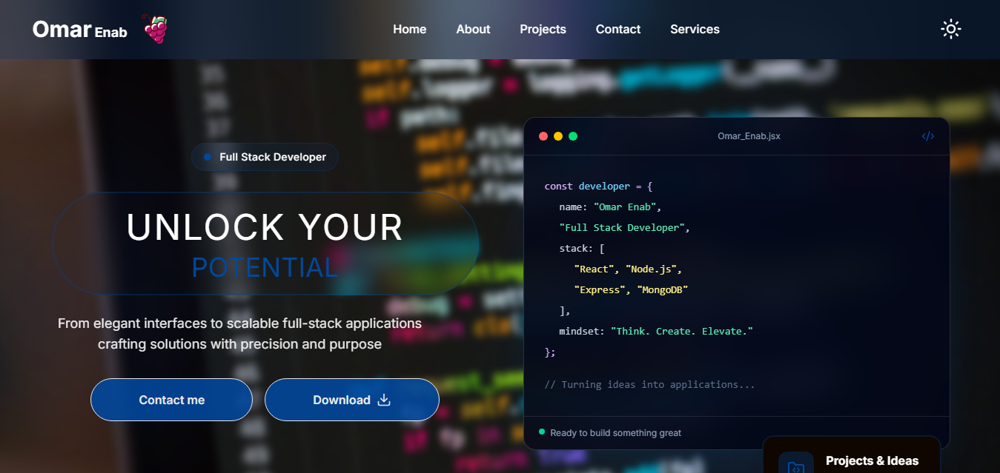

# 🚀 Portfolio — Full Stack Web Application

A personal portfolio built to showcase my projects, technical skills, and experience as a Full Stack Developer.

Beyond the visual presentation, this project focuses on **clean architecture, modularity, maintainability, and scalability**, applying software engineering principles across both the frontend and backend.

## 🌐 Portfolio Preview

## 🛠️ Tech Stack

### Frontend

- React.js
- Vite
- Tailwind CSS
- React Router
- Axios
- React Hook Form
- Zod
- Context API

### Backend

- Node.js
- Express.js
- MongoDB
- Mongoose
- Multer
- Resend

## 🏗️ Architecture & Development Principles

One of the main goals of this project was to build an application that is easy to understand, maintain, and extend rather than simply making it functional.

### 1. Component Reusability & Modularity

Reusable components are shared across different sections of the application to reduce code duplication and maintain a consistent UI.

This approach improves modularity and makes future modifications easier without having to rewrite the same functionality in multiple places.

### 2. Separation of Concerns & Single Responsibility Principle

Each component is designed primarily to handle its UI responsibilities, while application logic is separated into custom React hooks.

This keeps components focused, readable, and easier to maintain.

### 3. API Service Layer with Axios

All API communication is centralized through an Axios-based service layer.

Instead of placing HTTP requests directly inside UI components, API operations are separated into dedicated service functions.

This makes the application easier to maintain and allows API configurations and request handling to be managed in one place.

### 4. Backend MVC Architecture

The backend follows the Model-View-Controller (MVC) architectural pattern to organize application responsibilities.

- **Models:** Define database schemas and data structures.
- **Controllers:** Handle incoming requests and coordinate application logic.
- **Routes:** Define API endpoints and connect requests to their corresponding controllers.

### 5. Context API for Theme Management

The application supports light and dark themes using React Context API.

A shared context provides centralized theme management without repeatedly passing theme properties through multiple component levels.

Redux was not necessary for the current application requirements, so Context API provided a simpler solution.

### 6. Form Validation with Zod

Zod is used to validate form data and enforce a consistent data structure before submission.

Combined with React Hook Form on the frontend, it provides structured validation and improves the reliability of submitted data.

### 7. Email Notifications with Resend

The contact form integrates with Resend to send email notifications whenever a visitor submits a message.

This allows me to receive visitor inquiries directly in my email.

## ✨ Key Features

- Responsive design across different screen sizes.
- Dynamic portfolio content fetched through backend APIs.
- Reusable UI components.
- Centralized API communication.
- Light and dark theme support.
- Validated contact form.
- Email notifications for submitted messages.
- Organized backend using MVC architecture.
- Project and skills management through API endpoints.

## 🔮 Future Improvements

- **Admin Dashboard:** Manage portfolio content dynamically.
- **Content Management:** Improve flexibility when updating projects, skills, and personal information.
- **Docker:** Containerize the frontend and backend.
- **CI/CD:** Automate checks and streamline deployment.
- **Performance Optimization:** Continue improving loading times and user experience.

## 🎯 Project Philosophy

My goal with this project is to apply software engineering principles to real-world web development.

I believe a good application is not only about how it looks or whether it works, but also about how well its code is structured, how easily it can be maintained, and how effectively it can evolve as requirements grow.

---

**Developed by Omar Enab**
